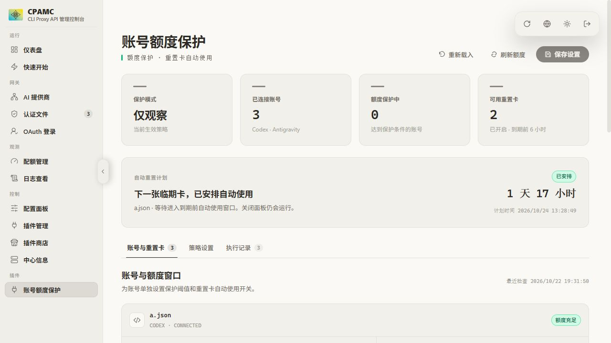

# CPA Quota Guard

Per-account quota reserves and automatic use of expiring Codex reset credits for CLIProxyAPI, configured inside CPAMC.

[中文](README.md) · [Installation](docs/INSTALLATION.md) · [Configuration](docs/CONFIGURATION.md) · [Testing](docs/TESTING.md)

Independent community plugin; not affiliated with CLIProxyAPI, CPAMC, OpenAI, or Google.



## Features

- Per-account or per-window minimum remaining quota, a safety margin, and recovery hysteresis.
- Observe/enforce modes, stale quota handling, priority-aware round-robin or fill-first scheduling.
- Codex and Antigravity quota adapters.
- Server-side use of expiring Codex reset credits, configurable lead time and account switches.
- Durable redemption IDs and event history for verification after failures or restarts.
- Existing CPAMC login and theme, without a second plugin login or credentials copied to the iframe.
- Native-style controls and motion, keyboard tabs, responsive layout, and reduced-motion support.

## Verified compatibility

CLIProxyAPI **8.0.35**, C ABI 1 / JSON schema 6; CPAMC **1.26.5** with the exact verified HTML build. The installer rejects unknown panel hashes before making changes. The packaged library targets Linux amd64 / glibc and is built on Ubuntu 24.04. Other versions and platforms have not been verified.

The Linux installer requires Python 3, PyYAML, and systemd. Source builds require Go 1.23+ and a C compiler; Go 1.27.3 is used for validation.

## Install

Download the archive and `SHA256SUMS` from this repository's Releases:

```bash
sha256sum -c SHA256SUMS
tar -xzf cpa-quota-guard_0.2.1_linux_amd64.tar.gz
cd cpa-quota-guard-0.2.1
sha256sum -c dist/SHA256SUMS
python3 install.py  # read-only plan
sudo python3 install.py --apply --management-key-file /root/cpa-management.key
```

The key file must contain your existing CPA management key and be readable only by root. The installer backs up the library, configuration, and panel, restarts CPA, verifies registration, and rolls back on failure. Open **账号额度保护** in CPAMC after signing in normally. See the installation guide for rollback and custom paths.

**Initial defaults: quota protection observes only; automatic credit use is enabled with a six-hour lead. These are independent.** To prevent automatic redemption from the first startup, preseed the disabled policy described in the installation guide.

## Important behavior

Quota protection is best-effort. In-flight requests, other clients, delayed quota data, and host fallback can still spend quota. A protected window pauses the whole account; plugin scheduling replaces native selection for matching enabled rules.

The upstream consume endpoint cannot select a particular credit. If a different credit becomes unavailable, the plugin pauses that account until the target credit expires. Successful redemption depends on upstream availability and account authorization. Do not delete the durable journal while the service is running.

## Build and contribute

```bash
git clone https://github.com/Wuse777/cpa-quota-guard.git
cd cpa-quota-guard
bash build.sh
```

See [CONTRIBUTING.md](CONTRIBUTING.md) and [docs/TESTING.md](docs/TESTING.md). Unit and isolated integration tests use fake accounts; production credentials, logs, and runtime state are not part of this repository.

MIT license; upstream and dependency notices are preserved in [NOTICE](NOTICE) and [licenses/](licenses/). Report vulnerabilities as described in [SECURITY.md](SECURITY.md).
