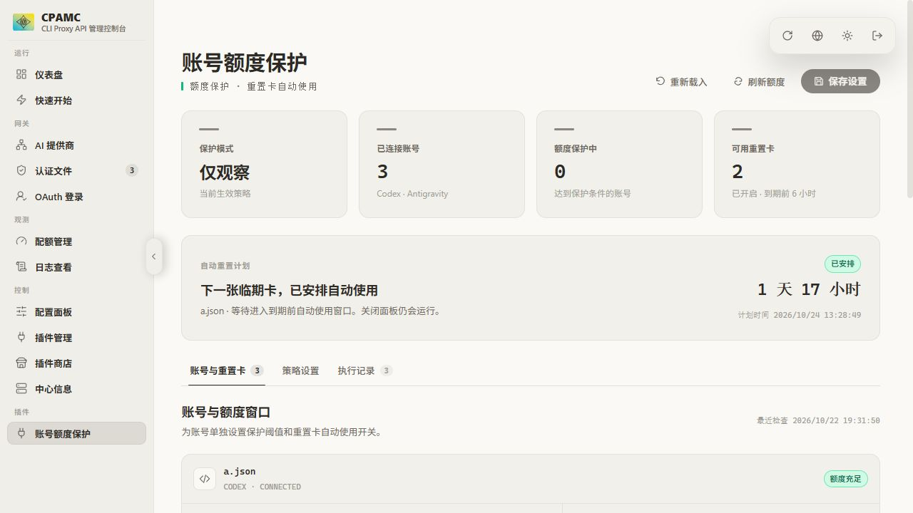

# CPA Quota Guard

为 CLIProxyAPI 提供**按账号保留额度**与 **Codex 临期重置卡自动使用**，在 CPAMC 内直接查看和配置。

[English](README.en.md) · [安装与回滚](docs/INSTALLATION.md) · [配置说明](docs/CONFIGURATION.md) · [测试](docs/TESTING.md) · [更新记录](CHANGELOG.md)

这是独立社区插件，非 CPA、CPAMC、OpenAI 或 Google 官方项目。



## 功能

- 账号通用最低剩余比例，或按额度窗口单独设置。
- 提前停止余量与恢复间隔，减少账号在阈值附近反复切换。
- 观察 / 执行模式、未知额度处理、轮询 / 依次使用与账号优先级。
- Codex、Antigravity 额度查询；其他服务商尚未适配。
- Codex 重置卡到期前自动使用，支持提前时间、总开关和账号开关。
- 持久化兑换请求编号与执行记录，重启后核实未完成请求。
- 直接沿用 CPAMC 登录会话及主题；无插件二次密钥登录。
- 原生风格控件与动效、键盘标签导航、窄屏排版和减少动态效果支持。

## 兼容范围

| 项目 | 已验证范围 |
| --- | --- |
| CLIProxyAPI | 8.0.35，原生 C ABI 1 / JSON schema 6 |
| CPAMC | 1.26.5，且必须是已核验的 HTML 构建 |
| 服务端 | Linux amd64 / glibc；当前构建环境 Ubuntu 24.04 |
| 安装器 | Python 3、PyYAML、systemd；默认服务和用户为 `cliproxyapi` |
| 构建 | Go 1.23+、C 编译器；当前验证 Go 1.27.3 |

版本号相同的重新打包面板也可能哈希不同。安装器在修改前校验面板，不接受未知构建；详情见 [兼容性说明](docs/COMPATIBILITY.md)。其他 CPA / CPAMC 版本、操作系统或架构尚未验证。

## 快速开始

从本仓库 **Releases** 下载 Linux amd64 安装包和外部 `SHA256SUMS`。解压前后分别校验：

```bash
sha256sum -c SHA256SUMS
tar -xzf cpa-quota-guard_0.2.2_linux_amd64.tar.gz
cd cpa-quota-guard-0.2.2
sha256sum -c dist/SHA256SUMS

# 安装器需要 Python 的 yaml 模块；Debian / Ubuntu 可使用发行版软件包。
sudo apt-get install python3-yaml
python3 install.py  # 只显示计划，不修改服务
```

将现有 CPA 管理密钥保存为服务器上仅 root 可读的文件，然后执行：

```bash
sudo python3 install.py --apply --management-key-file /root/cpa-management.key
```

安装器备份共享库、配置和面板，应用插件后重启 CPA 并验证注册；失败会回滚。完整说明及自定义路径见 [安装文档](docs/INSTALLATION.md)。

打开 CPAMC，登录后进入侧栏 **账号额度保护**：查看额度，设置账号或窗口阈值，再保存策略。无需再次输入管理密钥。

**首次启动默认：额度保护为“只观察”，自动使用重置卡开启、提前 6 小时。** 两者相互独立；观察模式不会暂停自动兑换。若不希望自动使用，应在安装前预设关闭策略，或在页面策略设置中关闭总开关；首次安装前关闭的方法见安装文档。

0.2.2 的卡片查询与兑换通过 CPA 管理接口转发，与 CPAMC 手动重置共用调用路径。升级请运行新版安装器，配置本机管理地址及 0600 私有密钥文件；仅替换共享库不足以启用此调用方式。执行记录保留脱敏失败详情，列表查询成功和重启不会清除最近兑换错误。

## 行为与限制

例如保留 20%、提前停止 3 个百分点、恢复间隔 5 个百分点：剩余 ≤23% 时避让账号，成功查询到 ≥28% 后恢复。任一受保护窗口触线会保护整个账号。额度是查询快照，在途请求及其他客户端仍可消耗，因此不能承诺绝对余额下限。

自动兑换在服务器后台运行，关闭页面后仍会继续。卡片必须为可用的 `codex_rate_limits` 类型；请求编号和执行记录先落盘，结果不明确时核实并沿用原编号重试。

**上游接口不能指定消耗哪张卡。** 若发现其他卡变为不可用，插件会暂停该账号兑换至目标卡到期并记录原因；兑换是否成功仍取决于上游接口与授权。不要在服务运行时删除 `reset-journal.json`。

命中启用规则的请求使用插件调度，CPA 原有加权或亲和性不会同时参与这次选择。宿主停用、熔断或无法加载插件时可能回退内置调度。更多细节见 [配置与行为](docs/CONFIGURATION.md)。

## 从源码构建

```bash
git clone https://github.com/Wuse777/cpa-quota-guard.git
cd cpa-quota-guard
bash build.sh
```

`build.sh` 运行 Go race、vet 并生成 `dist/quota-guard.so` 和校验值。源码仓库不提交预编译二进制、账号、运行策略或服务器日志。

开发检查、隔离 CPA 模型调用、systemd 安装/回滚、浏览器验收见 [测试文档](docs/TESTING.md)。欢迎按照 [贡献指南](CONTRIBUTING.md) 提交问题或改进。

## 许可证

本项目使用 [MIT 许可证](LICENSE)。上游 C ABI、CPAMC 界面适配和依赖许可保留在 [NOTICE](NOTICE) 与 [licenses/](licenses/)。截图仅使用虚构测试账号。安全问题报告方式见 [SECURITY.md](SECURITY.md)。
